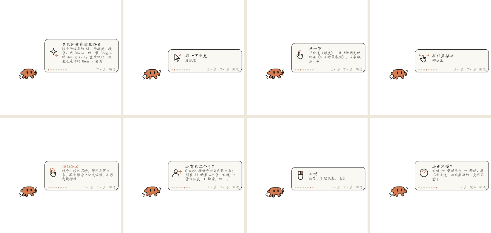

# Clawdex (克代同堂)

**Claude and Codex, working as one team.** A little Clawd sits on your desktop and shows how much quota you have left. Small tasks with a clear plan get handed to Codex (or back to Claude) without you asking, and when one account runs out you can switch accounts and bring your unfinished conversations along.

[中文说明](README.zh-CN.md)

> **The author is looking for a job!** If you have an opportunity, see [my website](https://miaomiaoyang.netlify.app) or reach out on [LinkedIn](https://www.linkedin.com/in/miaomiao-yang-331901383) · Xiaohongshu (RedNote) @羊猫猫不是猫 · [more](#contact)



## What it does

- **Quota at a glance.** Clawd rides a rocket, then a skateboard, runs, drags its feet, and finally lies down as your Claude quota runs out. Click it to see the track for "this 5 hours" or "this week", with the time it refills. The track shows whichever limit is closer to running out.
- **Delegation, without being asked.** Every message carries a short reminder for the main AI: if part of the task just follows an agreed plan (code, bug fixes, scripts, batch edits, research), hand it to a teammate with a full handoff note, then do the judgment parts yourself. Claude → Codex uses OpenAI's official Codex plugin; Codex → Claude uses the cc plugin.
- **A team list per account.** Settings lists every account (Claude 1, Claude 2, Codex …). The one you are using right now is greyed out ("in use · not delegated to itself"). Each account can have clones with their own model and job.
- **Switch accounts without losing work.** Press and hold Clawd: teammates who can take over appear above it. Drop Clawd on Codex or Gemini to continue there (3 seconds to undo). When you sign in to another Claude account, Clawd notices and offers to bring over the old account's conversations, using the bundled `account-move` skill.

Currently tested: delegation between **Claude and Codex**; switching to **Claude, Codex and Gemini** (Gemini runs through Google's Antigravity, using your Gemini plan). Kimi, GitHub Copilot and Cursor are detected but not tested yet.

Clawdex only cares about **subscription quota** (plans that run out and refill). Pay-as-you-go API keys are out of scope.

## Requirements

- Windows 10/11
- The Claude desktop app (Code tab), or Claude Code
- [Node.js](https://nodejs.org/) (for the floating window) and Python 3 (for the account-move skill)
- **For delegation to Codex:** the [Codex CLI](https://github.com/openai/codex) (`npm install -g @openai/codex`, then `codex login`) and OpenAI's [Codex plugin for Claude Code](https://github.com/openai/codex-plugin-cc)
- **For Codex → Claude:** the [cc plugin for Codex](https://github.com/sendbird/cc-plugin-codex) (`codex plugin marketplace add sendbird/codex-marketplace`, `codex plugin add cc@sendbird`, then `$cc:setup` inside Codex)
- Optional, for Gemini: [Antigravity](https://antigravity.google/), signed in with your Google account

## Install

Easiest: tell your AI **"follow AI-SETUP.md and set up Clawdex for me"**. It checks your computer, asks one question at a time, and runs the commands.

By hand:

```bash
git clone https://github.com/Miaomiaomeowmeow/clawdex.git
cd clawdex
```

1. **Plugin** (loaded in every new Claude conversation):
   ```bash
   claude plugin marketplace add ./plugin
   claude plugin install clawdex@clawdex --scope user
   ```
2. **Floating window:**
   ```bash
   cd float
   npm install
   ```
3. **Account-move skill:** copy `skills/account-move` into your Claude config folder's `skills` folder (`%USERPROFILE%\.claude\skills\`, or `CLAUDE_CONFIG_DIR\skills\` if you set one).
4. Open a **new** Claude conversation. Clawd appears on your desktop and shows the first-run tips once. You can also type `/clawdex`, or double-click the "克代同堂" shortcut on your desktop.

## How to use

| Do this to Clawd | What happens |
|---|---|
| Hover | Teammates peek out behind it |
| Click | Opens the quota track; click the bar to switch between 5 hours and this week |
| Press and drag | Moves Clawd |
| Press and hold still | Teammates who can take over appear above; drop Clawd on one to hand over |
| Right-click | Language, Manage teammates (settings), Quit |

Everything else (each feature, what each AI can do, first-time setup) is in **Right-click → Manage teammates → Help**.

## Folders

| Folder | What's inside |
|---|---|
| `plugin/` | The Claude Code plugin (quota, delegation tool, per-message reminder, account detection) |
| `float/` | The floating window (Electron) |
| `pages/` | The track, settings and move-list pages the window shows; font in `pages/fonts/` |
| `src/` | Page templates, hand-drawn-style art and the build scripts that embed the art into `pages/` |
| `skills/account-move/` | The account-move skill |

## Contact

- LinkedIn: [Miaomiao Yang](https://www.linkedin.com/in/miaomiao-yang-331901383) (new projects get posted there too)
- Xiaohongshu (RedNote): @羊猫猫不是猫
- GitHub: [Miaomiaomeowmeow](https://github.com/Miaomiaomeowmeow) (my other projects)
- Personal site: [miaomiaoyang.netlify.app](https://miaomiaoyang.netlify.app); my email is there too

## Credits & license

Made by **Miaomiao** ([@Miaomiaomeowmeow](https://github.com/Miaomiaomeowmeow)). The hand-drawn-style characters were generated with AI under her direction.

Licensed under [CC BY-NC-SA 4.0](https://creativecommons.org/licenses/by-nc-sa/4.0/): you can share and remix it with credit, share your version under the same license, and not use it commercially. If you build something on Clawdex, I would love to hear about it.

Font: ChillRound (寒蝉半圆体), based on Zen Maru Gothic, [SIL Open Font License 1.1](pages/fonts/OFL.txt).

Clawd is the Claude Code mascot; Claude, Codex, Gemini and the other names belong to their owners. This is a fan project and is not affiliated with Anthropic, OpenAI or Google. Optional helpers it works with: [claude-swap](https://github.com/realiti4/claude-swap) (MIT).
