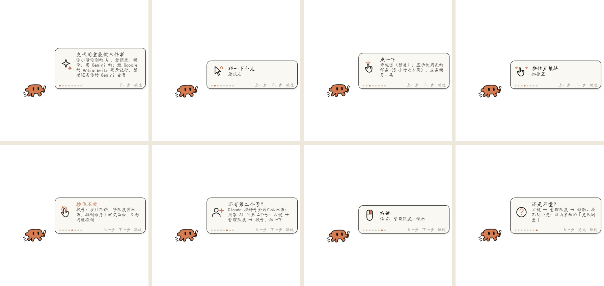

# 克代同堂 Clawdex

**让 Claude 和 Codex 像一个小队一样干活。** 桌面上一只小克，告诉你额度还剩多少；照方案就能做的小活，主 AI 不等你开口就交给 Codex（或者交回给 Claude）；一个号额度用完了，换个号，没做完的对话一起接过来。

[English](README.md)

> **作者在找工作！** 有机会的话看看[我的网站](https://miaomiaoyang.netlify.app)，或者在[领英](https://www.linkedin.com/in/miaomiao-yang-331901383)找我 · 小红书 @羊猫猫不是猫 · [更多](#联系我)



## 能做什么

- **一眼看额度**：额度越用越少，小克从坐火箭 → 滑滑板 → 跑步 → 拖着脚 → 趴下喘气。点小克铺开跑道，看「这 5 小时」或「本周」用了多少、几点回满；跑道自动显示快用完的那条，点一下条换另一条。
- **主动派活**：你每发一条消息，主 AI 都会收到一句提醒：这件活里有「照方案就能做」的部分（写代码、改 bug、写脚本、批量改文件、查资料），就先填好交接单交给队友，自己去做要拿主意的部分。Claude → Codex 用 OpenAI 官方的 Codex 插件，Codex → Claude 用 cc 插件。
- **按号列的队伍名单**：设置页把所有号都列出来（Claude 1、Claude 2、Codex……），你正在用的那个号变灰，写着「正在用 · 不派给自己」。每个号可以加分身，各自换模型、写负责什么、调派活强度。
- **换号不丢活**：按住小克不动，能接手的队友会冒到它头顶，拖到 Codex 或 Gemini 身上就交给它接着做（3 秒内能撤销）。你在 Claude 里换了另一个号，小克会认出来，问你要不要把旧号的对话接过来（用仓库里自带的 `account-move` 搬家技能）。

目前测过的：委派是 **Claude 和 Codex 互相派**；换号能换到 **Claude、Codex、Gemini**（Gemini 走 Google 自己的 Antigravity，用的还是你 Gemini 会员的额度）。Kimi、GitHub Copilot、Cursor 认得出，还没测过。

克代同堂只管**有会员额度的 AI**（会用完、会回满的那种）；自己填 Key、按用量付钱的 API 不在范围内。

## 需要先有

- Windows 10/11
- Claude 桌面应用（Code 标签页），或终端版 Claude Code
- [Node.js](https://nodejs.org/)（浮窗要用）和 Python 3（搬家技能要用）
- **要派活给 Codex：** [Codex 命令行](https://github.com/openai/codex)（`npm install -g @openai/codex`，再 `codex login`）和 OpenAI 官方的 [Claude Code 用 Codex 插件](https://github.com/openai/codex-plugin-cc)
- **要让 Codex 派活给 Claude：** [Codex 用的 cc 插件](https://github.com/sendbird/cc-plugin-codex)（`codex plugin marketplace add sendbird/codex-marketplace`、`codex plugin add cc@sendbird`，再在 Codex 里打 `$cc:setup`）
- 可选，用 Gemini 的：[Antigravity](https://antigravity.google/)，用你的 Google 账号登录

## 安装

最省事：跟你的 AI 说 **「照 AI-SETUP.md 帮我装克代同堂」**。它会先自己检查电脑，一次问你一个问题，再替你跑命令。

自己装：

```bash
git clone https://github.com/Miaomiaomeowmeow/clawdex.git
cd clawdex
```

1. **插件**（以后每个新开的 Claude 对话都会带上）：
   ```bash
   claude plugin marketplace add ./plugin
   claude plugin install clawdex@clawdex --scope user
   ```
2. **浮窗**：
   ```bash
   cd float
   npm install
   ```
3. **搬家技能**：把 `skills/account-move` 整个文件夹复制到 Claude 配置文件夹的 `skills` 里（`%USERPROFILE%\.claude\skills\`；设过 `CLAUDE_CONFIG_DIR` 的放到那里的 `skills\`）。
4. **新开**一个 Claude 对话，小克会出现在桌面上，第一次会教你怎么用。之后也可以在 Claude 里打 `/clawdex`，或双击桌面上的「克代同堂」。

## 怎么用

| 对小克做什么 | 会怎样 |
|---|---|
| 碰一下 | 队友从小克身后探出来 |
| 点一下 | 铺开额度跑道；点条换「5 小时 / 本周」 |
| 按住直接拖 | 挪位置 |
| 按住不动 | 能接手的队友冒到头顶，拖到谁身上就交给谁 |
| 右键 | 语言、管理队友（设置页）、退出 |

每样功能、每家 AI 能做什么、第一次装好要做什么，都在 **右键 → 管理队友 → 帮助** 里。

## 文件夹

| 文件夹 | 里面是什么 |
|---|---|
| `plugin/` | Claude Code 插件（额度、委派工具、每条消息的派活提醒、认号） |
| `float/` | 桌面浮窗（Electron） |
| `pages/` | 浮窗里显示的跑道、设置页、搬家清单；字体在 `pages/fonts/` |
| `src/` | 页面模板、手绘风形象、把形象嵌进 `pages/` 的生成脚本 |
| `skills/account-move/` | 搬家技能 |

## 联系我

- 领英：[Miaomiao Yang](https://www.linkedin.com/in/miaomiao-yang-331901383)（新作品也会发在那里）
- 小红书：@羊猫猫不是猫
- GitHub：[Miaomiaomeowmeow](https://github.com/Miaomiaomeowmeow)（我的其他项目）
- 个人网站：[miaomiaoyang.netlify.app](https://miaomiaoyang.netlify.app)，邮箱也在那里

## 署名和许可

作者 **Miaomiao**（[@Miaomiaomeowmeow](https://github.com/Miaomiaomeowmeow)）。手绘风形象由作者指导 AI 生成。

许可：[CC BY-NC-SA 4.0](https://creativecommons.org/licenses/by-nc-sa/4.0/deed.zh-hans)：可以分享、可以改，要署名；改了以后用同样的许可公开；不能商用。用克代同堂做了什么东西，很希望你告诉我。

字体：寒蝉半圆体（ChillRound，基于 Zen Maru Gothic），[SIL 开源字体许可 1.1](pages/fonts/OFL.txt)。

小克（Clawd）是 Claude Code 的吉祥物；Claude、Codex、Gemini 等名字归各自的公司所有。这是粉丝自制项目，跟 Anthropic、OpenAI、Google 都没有关系。可以一起用的小工具：[claude-swap](https://github.com/realiti4/claude-swap)（MIT）。
